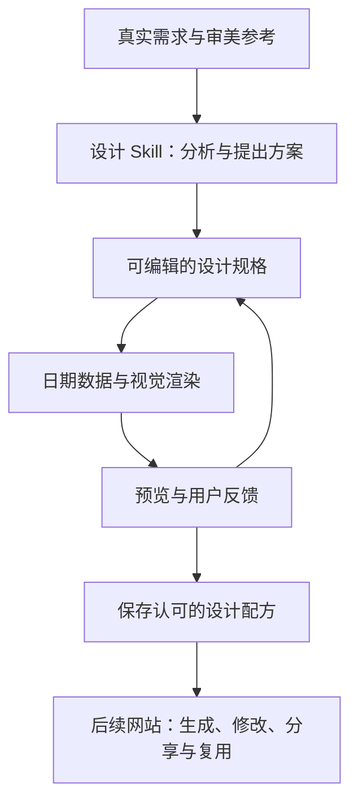

# How Your Days Fly

让每个人借助 AI，设计自己愿意使用的年历、月历、周历和日历。

最终目标是一个公众可访问的网站：访客可以表达对时间与视觉的偏好，生成和修改日历，保存作品，并复用站内原创或获授权的设计配方。名称暂定。

## 当前阶段

先验证日历设计能力，再把验证有效的方法开放到网站。

- 已有：项目专用的 `calendar-design-lab` skill 初稿，以及支持年、月、周、日的公历数据工具。
- 正在开始：[第一个真实设计实验](docs/first-experiment.md)。
- 尚未验证：设计满意度、反馈后的改进、跨用户效果、完整设计配方的重放。
- 尚未实现：视觉渲染器、网站、在线 AI 生成、分享与导出服务。



上图是拟建流程。当前日期数据工具只负责计算，不负责产生视觉设计。

## 使用当前能力

需要 Python 3.10 或以上；日期工具与测试不依赖第三方 Python 包。

在支持项目 skills 的 agent 中使用 `.agents/skills/calendar-design-lab/SKILL.md`。其他环境可直接读取该文件及其按需引用的资源。

生成日期数据：

```sh
python3 .agents/skills/calendar-design-lab/scripts/calendar_data.py --view year --date 2027-01-01 > calendar.json
python3 .agents/skills/calendar-design-lab/scripts/calendar_data.py --view month --date 2028-02-01
python3 .agents/skills/calendar-design-lab/scripts/calendar_data.py --view week --date 2027-01-01 --week-start sunday
python3 .agents/skills/calendar-design-lab/scripts/calendar_data.py --view day --date 2027-01-01
python3 -m unittest discover -s tests -v
```

输出包含连续日期及月份网格；月份网格保留相邻月份的真实日期，以 `in_month` 区分。日期工具采用公历，支持 2–9998 年，暂不计算农历、节气、法定假日或调休。

## 我们怎样判断进展

技术检查与用户的设计评价单独记录。日期正确、没有溢出，不等于用户愿意使用。

第一阶段需要完成：

1. 一份真实用户愿意使用的日历，记录具体满意和不满意的地方。
2. 一次根据反馈进行的定向修改，保留用户已经喜欢的部分。
3. 保存选定的设计规格、实现版本与素材后，再次渲染；随后验证换年份和另一位用户的需求。

年、月、周、日可以共享字体、素材和设计规则；各自的时间组织与使用场景仍需分别验证。

## 参考作品与素材

参考分析与可分发资产分开管理。只把自有或取得相应许可的字体、图片和模板纳入共享配方，并保留来源、版本及允许用途。AI 生成的内容也需要检查其来源与可分享范围。

原始参考上传、个人资料、密钥和本地输出默认不进入 Git。仓库暂未选择项目整体的开源许可证；公开可读不代表授予所有再利用权利。
