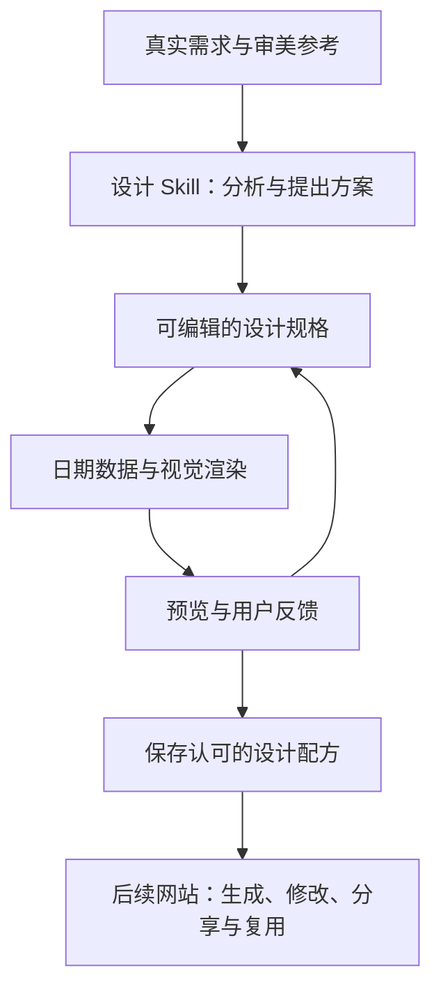
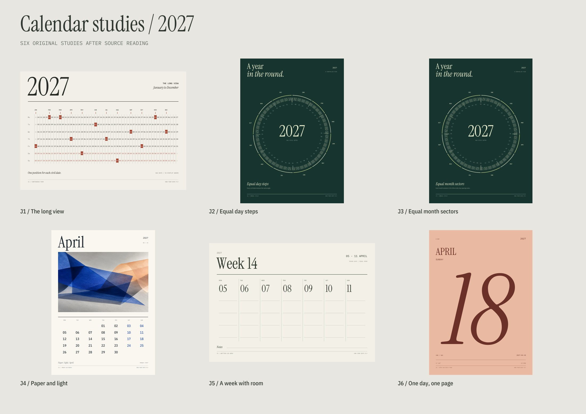

# How Your Days Fly

让每个人借助 AI，设计自己愿意使用的年历、月历、周历和日历。

最终目标是一个公众可访问的网站：访客可以表达对时间与视觉的偏好，生成和修改日历，保存作品，并复用站内原创或获授权的设计配方。名称暂定。

## 当前阶段

先验证日历设计能力，再把验证有效的方法开放到网站。

- 已有：项目专用的 `calendar-design-lab`、从公开资料精读提炼的条件性设计规则、公历数据工具、8 份结构样本、固定字体和素材的 6 份设计研究，以及按年／月／周／日分组的元素素材库。
- 正在开始：[第一个真实设计实验](docs/first-experiment.md)。
- 尚未验证：用户设计满意度、用户反馈后的改进、跨用户效果和通用设计生成能力。特定样本的资产重放及 2028 年变体已检查。
- 尚未实现：通用视觉设计引擎、网站、在线 AI 生成、分享与导出服务。当前样本渲染器是实验工具。



上图是拟建流程。当前日期数据工具只负责计算，不负责产生视觉设计。

## 第一轮设计模式样本

先以相近的中性视觉语言比较全年结构，再用月、周、日样本比较内容角色。样本均为原创研究，尚未获得用户的审美认可；它们不是封闭的产品模板清单。


[查看设计语法、样本映射与一手参考](.agents/skills/calendar-design-lab/references/patterns.md)。A–E 比较月份分区、连续周、月份条带、年轮和等日单元；F/G/H 分别展示图像主导月历、书写主导周历与单日日历。点击 SVG 可以查看源文件或完整尺寸。

[公开学习资料与练习路线](.agents/skills/calendar-design-lab/references/learning-guide.md)包括时间可视化开放教材、设计空间研究、排版指南和日历案例；逐项区分公开阅读范围与复用许可。

```sh
python3 scripts/render_pattern_atlas.py
python3 scripts/render_pattern_atlas.py --year 2028 --out-dir tmp/leap-studies
python3 scripts/render_pattern_atlas.py --pdf output/pdf/calendar-pattern-atlas.pdf
```

SVG 生成只用标准库；可选 PDF 导出需要 `reportlab`。SVG 源码可确定性重放，浏览器字形依赖本机字体；后续正式配方需固定字体版本。原图形与 `manifest.json` 保存在 `studies/pattern-atlas/`，PDF 和本地预览保存在忽略的 `output/`。

## 精读之后的新样本

本轮将 TimeViz、Timelines Revisited、Vignelli、数字排版与字体选择资料中的相关章节，提炼为[设计决策语言](.agents/skills/calendar-design-lab/references/design-language.md)，分别保存来源认识、迁移假设与验证结果。



J1 为横向连续年历；J2/J3 固定视觉条件比较等日／等月；J4 为原创光影图像月历；J5 为等面积书写周页；J6 为比例宽数字主导的单日页。它们是待用户评价的设计研究，详见[样本记录](studies/learned-language/README.md)。

```sh
python3 -m pip install -r requirements-design.txt
python3 scripts/render_language_studies.py --pdf output/pdf/learned-calendar-studies.pdf
python3 scripts/render_language_studies.py --year 2028 --out-dir tmp/learned-2028
python3 -m unittest discover -s tests -v
```

原始开放字体、许可证、所选生成图像及来源记录位于 `assets/`。SVG 使用字形轮廓并嵌入选定图像；可编辑文字和布局保留在源码，设计卡与素材/实现哈希保存在 manifest。生成器会拒绝与记录不一致的素材。当前新样本只检查所用英文、数字与符号的覆盖，尚未验证多语言排版。

## 按年／月／周／日检索素材

新增[设计元素与素材库](docs/material-library.md)：20 条官方案例研究、8 张逐件核验的 CC0 馆藏图像、16 个原创向量部件，按时间尺度分组，并关联已有字体及生成图像。每项保留用途、组合／跨尺度建议、权利范围及来源；研究案例与可分发资产分开。


```sh
python3 scripts/material_catalog.py --scale month
python3 scripts/material_catalog.py --scale week --kind component --json
python3 scripts/material_catalog.py --scale day --shareable-only --json
```

这批图像是屏幕研究版，还不是十二月／365 日完整系列；大幅打印要另取官方高分辨率版本并留档。素材板展示组合起点，尚未选定用户风格。

## 使用当前能力

需要 Python 3.10 或以上；日期工具与测试不依赖第三方 Python 包。

在支持项目 skills 的 agent 中使用 `.agents/skills/calendar-design-lab/SKILL.md`。其他环境可直接读取该文件及其按需引用的资源。

生成日期数据：

```sh
python3 .agents/skills/calendar-design-lab/scripts/calendar_data.py --view year --date 2027-01-01 > calendar.json
python3 .agents/skills/calendar-design-lab/scripts/calendar_data.py --view month --date 2028-02-01
python3 .agents/skills/calendar-design-lab/scripts/calendar_data.py --view week --date 2027-01-01 --week-start sunday
python3 .agents/skills/calendar-design-lab/scripts/calendar_data.py --view day --date 2027-01-01
python3 -m unittest discover -s tests -v
```

输出包含连续日期及月份网格；月份网格保留相邻月份的真实日期，以 `in_month` 区分。日期工具采用公历，支持 2–9998 年，暂不计算农历、节气、法定假日或调休。

## 我们怎样判断进展

技术检查与用户的设计评价单独记录。日期正确、没有溢出，不等于用户愿意使用。

第一阶段需要完成：

1. 一份真实用户愿意使用的日历，记录具体满意和不满意的地方。
2. 一次根据反馈进行的定向修改，保留用户已经喜欢的部分。
3. 保存选定的设计规格、实现版本与素材后，再次渲染；随后验证换年份和另一位用户的需求。

年、月、周、日可以共享字体、素材和设计规则；各自的时间组织与使用场景仍需分别验证。

## 参考作品与素材

参考分析与可分发资产分开管理。只把自有或取得相应许可的字体、图片和模板纳入共享配方，并保留来源、版本及允许用途。AI 生成的内容也需要检查其来源与可分享范围。

原始参考上传、个人资料、密钥和本地输出默认不进入 Git。仓库暂未选择项目整体的开源许可证；公开可读不代表授予所有再利用权利。
