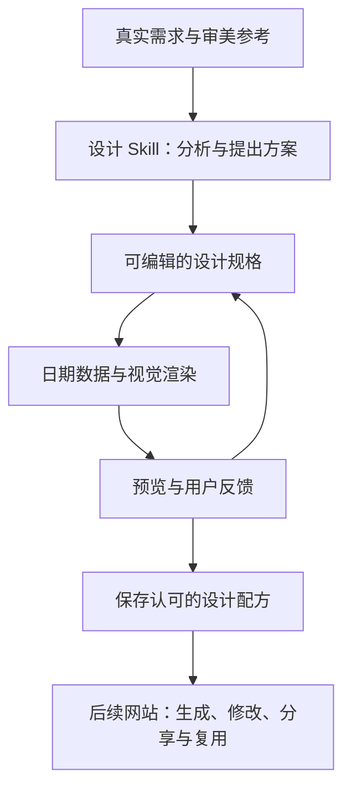

# How Your Days Fly

让每个人借助 AI，设计自己愿意使用的年历、月历、周历和日历。

最终目标是一个公众可访问的网站：访客可以表达对时间与视觉的偏好，生成和修改日历，保存作品，并复用站内原创或获授权的设计配方。名称暂定。

## 当前阶段

先验证日历设计能力，再把验证有效的方法开放到网站。

- 已有：项目专用的 `calendar-design-lab`、从公开资料精读提炼的条件性设计规则、公历数据工具、8 份结构样本、固定字体和素材的 6 份设计研究，以及按年／月／周／日分组的元素素材库。
- 正在开始：[第一个真实设计实验](docs/first-experiment.md)。
- 尚未验证：用户设计满意度、用户反馈后的改进、跨用户效果和通用设计生成能力。特定样本的资产重放及 2028 年变体已检查。
- 尚未实现：通用视觉设计引擎、网站、在线 AI 生成、分享与导出服务。当前样本渲染器是实验工具。



上图是拟建流程。当前日期数据工具只负责计算，不负责产生视觉设计。

## 统一设计入口

前三轮资料已按设计决策整合到[日历设计总览](docs/design-atlas.md)：**时间结构 → 设计原则 → 素材选择 → 已有样本 → 新配方与验证**。总览按年／月／周／日组织，具体定义、来源和资产仍以各原始文件为准。

现有 8 种结构词汇、9 条带来源的规则、14 份样本（A–H、J1–J6），以及 20 条新收集的官方案例、早期案例、8 组学习来源和素材记录。结构家族与样本数量分开；模块式日期组合尚无本地成品样本。

```sh
# 一次查出某一尺度的结构、规则、样本和素材，不必分别翻三套目录。
python3 scripts/design_catalog.py --scale month
python3 scripts/design_catalog.py --scale week --json

# 来源或样本有改动后，同时刷新素材索引与设计关系。
python3 scripts/design_catalog.py --build

# 专门筛选具有明确开放许可的素材时，仍可使用素材入口。
python3 scripts/material_catalog.py --scale day --shareable-only --json
```

统一检索关联原始 manifest；A–H 与后读规则的对应标为当前建议，J 系列保留实际设计卡记录。新部件是编排候选，不倒写为原样本已经使用的素材。

| 想深入的问题 | 原始记录 |
| --- | --- |
| 时间怎样组织、结构有什么取舍 | [结构词汇](.agents/skills/calendar-design-lab/references/patterns.md) |
| 为什么这样排版、怎样判断和修改 | [设计语言](.agents/skills/calendar-design-lab/references/design-language.md)及关联阅读笔记 |
| 原始文献、设计者和案例在哪里 | [学习指南](.agents/skills/calendar-design-lab/references/learning-guide.md)、[年／月案例](docs/research/annual-monthly-materials.md)、[周／日案例](docs/research/weekly-daily-materials.md) |
| 可使用哪些图像、字体与部件 | [素材说明与四组素材板](docs/material-library.md) |
| 已有样本长什么样、实际用了什么 | [A–H 总览](studies/pattern-atlas/overview.svg)与[记录](studies/pattern-atlas/manifest.json)、[J1–J6 总览](studies/learned-language/overview.jpg)与[说明](studies/learned-language/README.md) |

原始字体、许可证、选定图像和版本均保留在 `assets/`；具体共享范围、预览图像的打印尺寸限制见素材说明。A–H 的 SVG 字形依赖本机字体；J 系列固定字体并输出字形轮廓，可编辑文字与布局保留在源码。尚未验证多语言排版。

## 使用当前能力

需要 Python 3.10 或以上；日期工具与测试不依赖第三方 Python 包。

从[设计总览](docs/design-atlas.md)开始；在支持项目 skills 的 agent 中使用 `.agents/skills/calendar-design-lab/SKILL.md`。其他环境可直接读取该文件及其按需引用的资源。

生成日期数据：

```sh
python3 .agents/skills/calendar-design-lab/scripts/calendar_data.py --view year --date 2027-01-01 > calendar.json
python3 .agents/skills/calendar-design-lab/scripts/calendar_data.py --view month --date 2028-02-01
python3 .agents/skills/calendar-design-lab/scripts/calendar_data.py --view week --date 2027-01-01 --week-start sunday
python3 .agents/skills/calendar-design-lab/scripts/calendar_data.py --view day --date 2027-01-01
python3 -m unittest discover -s tests -v
```

输出包含连续日期及月份网格；月份网格保留相邻月份的真实日期，以 `in_month` 区分。日期工具采用公历，支持 2–9998 年，暂不计算农历、节气、法定假日或调休。

重建已有研究：

```sh
python3 scripts/render_pattern_atlas.py
python3 -m pip install -r requirements-design.txt
python3 scripts/render_language_studies.py
python3 scripts/build_material_library.py
python3 scripts/design_catalog.py --build
```

A–H 的 SVG 生成只用标准库；J 系列与素材部件需 `requirements-design.txt`。两个样本渲染器支持可选 `--pdf` 输出，详见 `--help`；本地成品放入忽略的 `output/`。这些是特定研究的渲染工具。


## 我们怎样判断进展

技术检查与用户的设计评价单独记录。日期正确、没有溢出，不等于用户愿意使用。

第一阶段需要完成：

1. 一份真实用户愿意使用的日历，记录具体满意和不满意的地方。
2. 一次根据反馈进行的定向修改，保留用户已经喜欢的部分。
3. 保存选定的设计规格、实现版本与素材后，再次渲染；随后验证换年份和另一位用户的需求。

年、月、周、日可以共享字体、素材和设计规则；各自的时间组织与使用场景仍需分别验证。

## 参考作品与素材

参考分析与可分发资产分开管理。只把自有或取得相应许可的字体、图片和模板纳入共享配方，并保留来源、版本及允许用途。AI 生成的内容也需要检查其来源与可分享范围。

原始参考上传、个人资料、密钥和本地输出默认不进入 Git。仓库暂未选择项目整体的开源许可证；公开可读不代表授予所有再利用权利。
