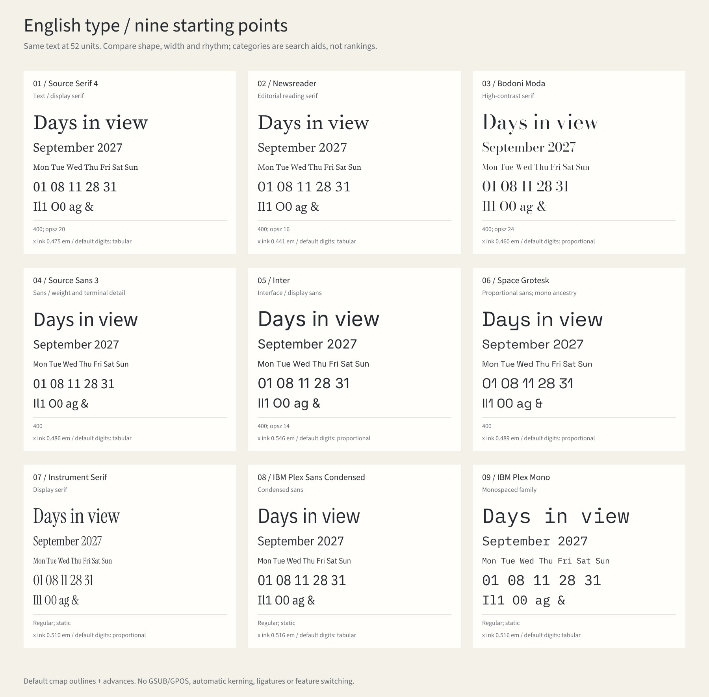
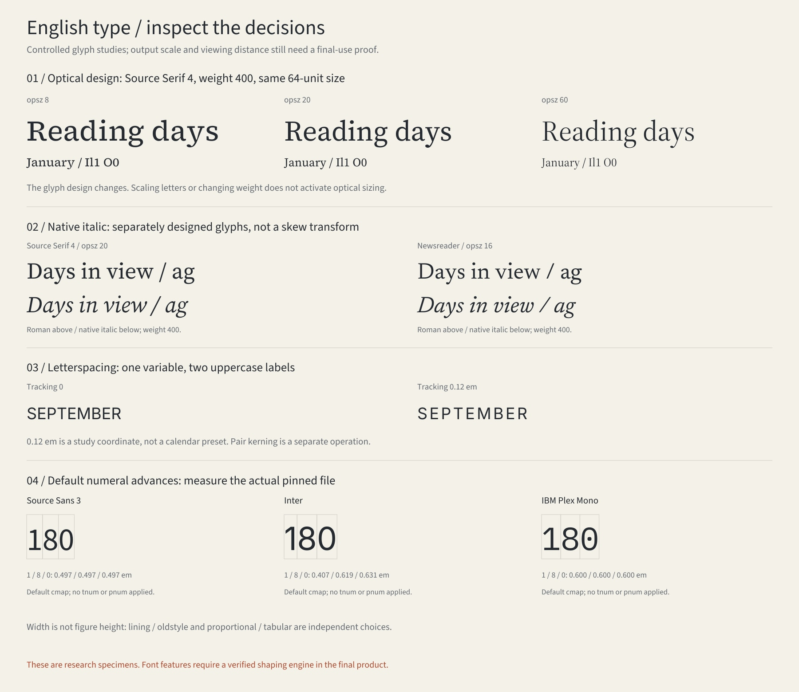

# 英文字体：从字形到日历角色

2026-10-30。本页补充[字体与排版专题](type-layout-library.md)，并接入相同的年／月／周／日素材索引。本轮增加 **14 条一手页面阅读记录、6 个保留字体家族、5 个条件设计条目和2张原创研究板**。连同已有3个西文字体家族，研究板比较9个候选；它们不是封闭的风格全集或用户认可的推荐清单。

## 已有研究与本轮补足

上一轮的 [font-selection](research/font-selection.md) 已研究西文字体搭配、骨架、数字与光学尺寸，保留 Instrument Serif、IBM Plex Mono、IBM Plex Sans Condensed；实际字样展示以中文比较为主。

本轮补齐具体候选的原设计说明、文件测量和英文真实词句。新增精读见[家族与分类](research/latin-type-research.md)和[数字、字距与观看尺度](research/latin-calendar-reading.md)。来源正文、研究图观察、文件实测、项目迁移假设与用户评价分别记录；没有复制厂商作品图或字体样本册。

## 分类作为描述维度

[Monotype 的分类指南](https://www.monotype.com/resources/guide-type-styles)同时说明历史分类的局限。本项目用多个维度查找候选：

| 维度 | 要观察什么 | 用法与边界 |
| --- | --- | --- |
| 骨架与历史参考 | Humanist／Garalde／Transitional／Didone、grotesque／geometric等词汇 | 帮助描述形态；当代家族常跨类，不按标签决定情绪或审美高低 |
| 具体形态 | 笔画对比、x-height、开口、衬线、字宽、`a g` 与 `Il1 O0` | 看真实词句；分类不能代替逐文件与目标尺寸观察 |
| 用途与字宽组织 | display／text、condensed、mono／proportional | 分别描述用途、宽度、字符宽度组织，不能排成一套互斥类别 |
| 实际可用能力 | 字重、原生Italic、`opsz`、数字形式、GSUB／GPOS标签 | 字体包含、渲染器启用与输出正确是三件事 |

本轮没有保留 slab、script、blackletter 等全部类别的字体。它们仍可作为未来设计方向，不能以当前候选数量代表覆盖完毕。

## 九个候选放在同一张字样板



固定同一内容与名义字号，保留各自真实宽度和默认字形；**没有宣称相同视觉大小或可读性**。图中显示的字形 `x` 墨迹高度与默认数字宽度，来自该研究板实际使用的实例，不冒充已启用 `tnum`。

| 候选 | 原设计说明与本次比较方向 | 本次采用／保留范围 |
| --- | --- | --- |
| Source Serif 4 | 文字、展示与光学变化；与 Source Sans 配合有设计依据 | Roman／Italic，400；主板`opsz=20`，细节板另比较8／60 |
| Newsreader | 为连续屏幕阅读设计的编辑衬线；尝试同族标题与附注 | Roman／Italic，400、`opsz=16` |
| Bodoni Moda | 高对比方向；细笔画和目标尺寸、距离的关系 | Roman，400、`opsz=24`；不把 Bodoni* 产品陈述移用为文件事实 |
| Source Sans 3 | 比例、末端与中间字重的细节；日期和小附注候选 | Roman，400；文件原始默认是200 |
| Inter | Text／Display及近似字形、数字特性；查读候选 | Roman，400、`opsz=14`；未导入原生Italic |
| Space Grotesk | 从Mono演变的比例宽设计；保留有辨识度的细节 | Roman，400；原始默认300，不因mono来源将它误标等宽 |
| Instrument Serif | 原有窄体展示衬线；短标题与展示数字 | 本板采用既有Regular；原库另有原生Italic；长文效果另验 |
| IBM Plex Sans Condensed | 原有窄体方向；比较长月名与日期标签的空间 | 既有Regular静态文件；不是网页把字体横向压扁 |
| IBM Plex Mono | 原有等宽家族；比较数字与索引的节奏 | 既有Regular静态文件；并非所有日历都需等宽字体 |

具体原设计说明与阅读范围见研究记录；例如[Inter 官方说明](https://rsms.me/inter/)也有光学尺寸，[Space Grotesk 官方仓库](https://github.com/floriankarsten/space-grotesk)明确是比例宽。[Source Serif 的说明](https://github.com/adobe-fonts/source-serif/wiki/Source-Serif-Readme)可以支持配套家族的选择理由，不能替代整页效果比较。

## 可复用的五个选择条目

| ID／查询角色 | 帮助解决的问题 |
| --- | --- |
| `type-latin-anatomy`／`latin-anatomy` | 用骨架、宽度与视觉尺度解释具体候选差异 |
| `type-latin-italic`／`italic` | 同族正斜体是否足以承担书名、作者与附注分工 |
| `type-latin-optical`／`optical-sizing` | 固定其他变量比较真实光学实例，回到观看距离 |
| `type-latin-spacing`／`letterspacing` | kerning、tracking、opsz 分开，保留字距单位 |
| `type-latin-calendar-roles`／`latin-calendar-roles` | 按年／月／周／日的展示与查读任务组合字体 |

完整[条件条目](../assets/library/latin-type-elements.json)保留备选、取舍、反例、来源ID、候选文件和研究图；没有固定“书籍主题必选哪套字体”。

## 细节对照与实现边界



光学板使用 Source Serif 4 的实际`opsz`静态实例；Italic使用单独原生文件；字距板只改变显式tracking；数字框对应默认advance。上述对照可由现有轮廓路径实现。

[OpenType](https://learn.microsoft.com/en-us/typography/opentype/spec/features_pt)把比例／等宽数字与[等高／旧式](https://learn.microsoft.com/en-us/typography/opentype/spec/features_ko)分开。原始文件在400、其他轴默认值的实测中，Source Serif 4、Newsreader、Source Sans 3的Roman默认数字等宽；其余三个新增家族为比例宽。**Newsreader Italic默认“7”比其他数字宽**，不能由正体推断斜体。主板中的另选`opsz`结果单独保存在研究manifest。

当前`design_scene.py`仍是逐码点cmap／hmtx轮廓和显式tracking，未执行完整GSUB／GPOS、自动kerning、连字、数字替代或段落断行；这些研究图不冒充启用特性的效果图，也不证明最终打印或屏幕阅读性能。

## 按时间尺度使用

| 尺度 | 建议比较的真实内容与任务 | 回到整页要检查什么 |
| --- | --- | --- |
| 年 | 十二个月名、小日号、全年定位标签 | 列式查读、数字对齐、密度与远看定位 |
| 月 | `January`与`September`等长短月名、星期、日格 | 月份展示与日号查读的层级、行宽与留白 |
| 周 | 原创短书名、作者、七日标签与日期 | 同族正斜体或跨家族分工，主图与日期争夺注意的问题 |
| 日 | 大日号、完整日期、附注 | 单个数字的形态、展示张力与完整日期入口 |

这些是待验证的任务建议，不是对年历或周历只允许某种字体的规定。挂墙、桌面、屏幕、打印分别用目标尺寸与距离验证。

## 索引、字体与重建

```sh
python3 scripts/material_catalog.py --scale week --domain typography --tag latin --json
python3 scripts/material_catalog.py --tag latin --kind font --shareable-only --json
python3 scripts/material_catalog.py --domain typography --role italic --json
python3 scripts/material_catalog.py --domain typography --role letterspacing --json
python3 scripts/design_catalog.py --scale month --domain typography --json

python3 scripts/render_latin_type_atlas.py
python3 scripts/design_catalog.py --build
# JPG预览可选：sharp 0.35.5
node scripts/render_latin_type_previews.mjs /absolute/path/to/node_modules
```

六家族的八份原始VF与六份原始OFL合计约4.86MB，见[资产说明](../assets/fonts/latin-study/README.md)与[manifest](../assets/fonts/latin-study/manifest.json)。固定官方分发提交、逐文件来源、SHA-256与Git blob；没有导入本机商业字体。FontTools 4.68.0按明确轴值生成重命名的静态工作副本至被忽略的`tmp/latin-study-fonts/`，不修改源字体；OFL随工作副本保留。全部源字体体积不等于未来网页的加载方案。

SVG转曲、可编辑文本与坐标源码、实际字体实例指标、源文件及脚本哈希分别留存。原字体许可、项目原创研究的未选公共许可与研究来源的`research-only`范围分别记录。
