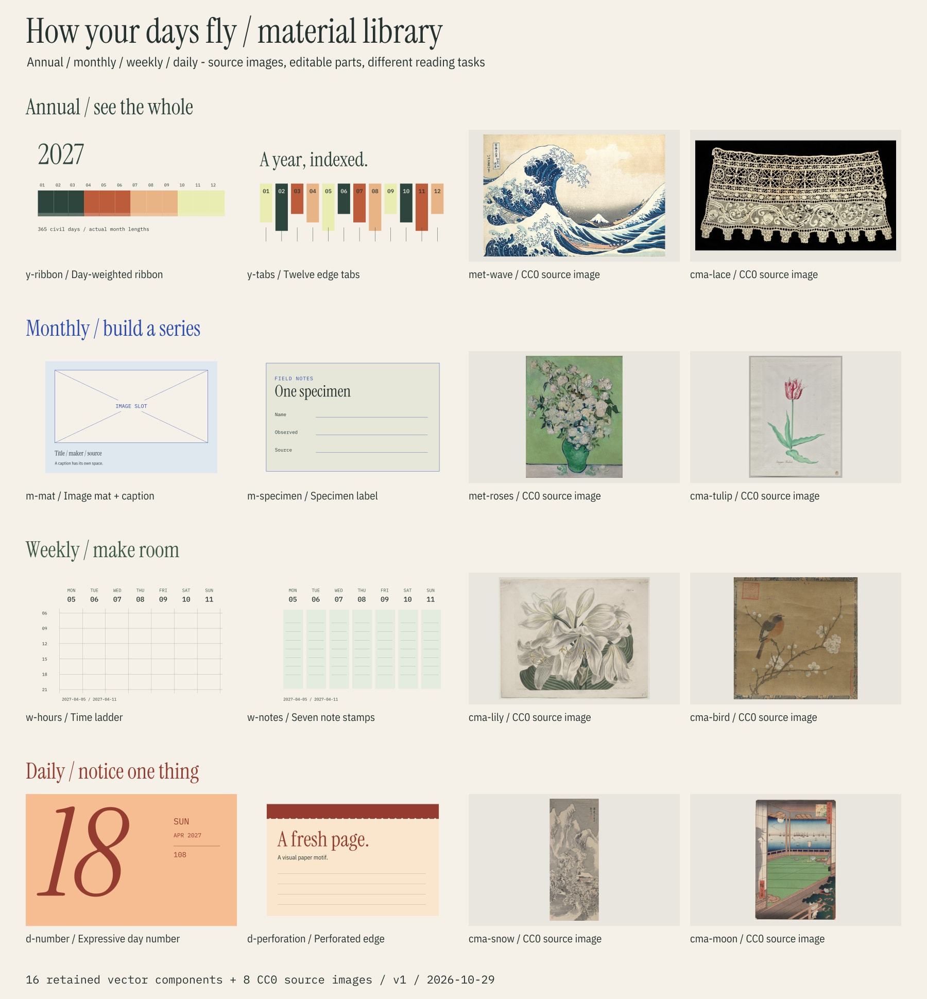
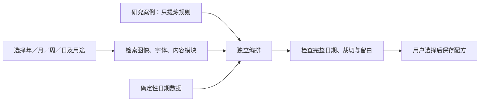

# 日历设计元素与素材库

统一使用入口已整理到[日历设计总览](design-atlas.md)：按时间尺度把结构模式、设计原则、A–H／J1–J6 与本素材库一起查。本页继续维护选材、授权、尺寸与素材重建的具体说明。

2026-10-30 更新。按年／月／周／日的观看与使用尺度分组，同一资产可以进入多组。现有 20 条日历官方案例、26 条字体／排版阅读记录、10 个带条件和取舍的设计条目、8 张逐件 CC0 图像、16 个原创向量部件，关联 5 个 OFL 字体家族和 1 张原创生成图像。另有 4 项未实现提案。

[字体与排版专题](type-layout-library.md)已接入相同索引，支持按领域、角色、关键词和许可筛选，并保留字样与原创构图研究。阅读参考、可分发字体与待验证的方法分别标注。



素材板只是组合起点；不是新一轮完整日历，也不表示用户已选择这些颜色或画家。每组板面展示 4 个部件和 2 张图像；总览只显示其中 2 个部件。

## 按时间尺度选材

| 分组 | 主要阅读任务 | 已研究的元素方向 | 本地部件 | 主图／内容候选 |
| --- | --- | --- | --- | --- |
| 年历 | 看全年、找跨月关系、看累积变化 | 连续周、径向层带、双专色索引、每日状态阵列 | 等日长度月份带、十二月侧签、四区织线、环形边饰 | 海浪横幅、蕾丝片段；也可用 12 个局部作月份索引 |
| 月历 | 当月查阅、观看主题、形成十二个月的系列 | 字体主题、植物、纹样、节气与食材、摄影、博物学图版 | 主图卡纸与图注、标本签、叠色色片、六行日期底座 | 玫瑰、郁金香、百合、花鸟，以及已有原创光影图 |
| 周历 | 安排、记录、比较七天 | 时轴、日期与自由笔记并置、昼夜渐变、开放分区、生活日志 | 时间梯、七张日记条、空白习惯矩阵、回顾与下周边栏 | 百合或花鸟作为一周主图；局部细节作为观察提示 |
| 日历 | 看见今天、揭示一个内容、留下短记录 | 每日艺术序列、同日跨年、摄影画廊、微挑战、万年历动作 | 展示型日号、撕页边饰、局部连载窗口、一日观察笺 | 雪景、月景，或同一张图的连续细节；保留原作身份 |

完整板面：[年历](../studies/material-library/year.jpg) · [月历](../studies/material-library/month.jpg) · [周历](../studies/material-library/week.jpg) · [日历](../studies/material-library/day.jpg)。SVG 与部件的可编辑 Python 源码也已保留。

上述主图分组是策展建议，不是排他分类，也不是气候事实。月景不代表已计算月相，雪景不自动属于某个地区的一月。8 张源图还不够组成完整的十二月或 365 日系列。

## 参考作品与可用资产

| 类型 | 内容／位置 | 用法 |
| --- | --- | --- |
| 设计研究 | [年／月 10 例](research/annual-monthly-materials.md)、[周／日 10 例](research/weekly-daily-materials.md) | 保留一手链接、观察证据、迁移规则；全部 `research-only`，没有导入商品图 |
| CC0 图像 | [8 件馆藏图像](../assets/library/open-images/README.md) | 已核验单件记录及机构政策，保留作者角色、出处、原字节、尺寸和 SHA-256 |
| 原创向量部件 | [16 件 SVG 与 manifest](../assets/library/components/manifest.json) | 同一项目中参数化组合；外部公共复用许可尚未选择，不自动标作开源素材 |
| 开放字体 | [原有 3 家族、7 文件](../assets/fonts/provenance.json)及[新增 2 家族原始 VF](../assets/fonts/type-study/manifest.json) | 保留 OFL，写明轴值，区分字体与渲染器支持；不是固定推荐搭配 |
| 字体／构图方法 | [10 个条件条目](../assets/library/type-layout-elements.json)与[研究专题](type-layout-library.md) | 记录取舍、反例、原始来源与原创研究图，尚非用户认可的配方 |
| 原创生成图像 | [Paper and light](../assets/images/paper-light/provenance.json) | 已保留选定原图与生成记录；不把生成来源记录等同于公共领域声明 |

[Met 的开放政策](https://www.metmuseum.org/hubs/open-access)与[Cleveland 的开放政策](https://www.clevelandart.org/open-access)允许使用其标为 CC0 的对应图像。清单同时保留单件 API 权利证据，不能据机构名称默认所有作品可用。CC0 与 OFL 只作用于相应文件，不改变仓库整体许可。

图像当前保存的是网页研究版，约 600–900 像素长边。每件记录了 300ppi 尺寸上限与官方高分辨率地址；需要大幅打印时另取高分辨率原图并重新留档。素材板中的放大展示不能证明打印质量。

## 如何组合



已完成的是检索索引、部件和素材板。图中用户选择与最终配方仍属于后续设计步骤。

可直接开始的四个组合：

- **全年索引海报**：`y-ribbon` + `y-tabs` + 海浪主图 + Plex Mono。月份宽度按真实天数；图像不覆盖查询区。
- **每月一件植物**：`m-mat` + `m-specimen` + `m-dock` + 图版。先统一裁切与图注，再补足十二张有权使用的素材；不凭主题猜花期。
- **一周观察与安排**：`w-hours` 或 `w-notes` + `w-margin` + 一张主图。时轴和自由记录是可选模式；周末是否等面积由使用需求决定。
- **一日一个细节**：`d-number` + `d-detail` + `d-observe` + 一个有权裁切的原作。保存每页裁切与日期映射；同图细节不冒充不同作者作品。

## 检索与重建

结构化总索引：[assets/library/catalog.json](../assets/library/catalog.json)。每项有尺度、类型、角色、标签、来源、权利范围与是否已有本地资产。`ready` 只表示资产存在；不表示完整系列、足够打印分辨率或用户已认可。

```sh
# 一次刷新素材索引及其结构／规则／样本关联；只需 Python 标准库。
python3 scripts/design_catalog.py --build
python3 scripts/design_catalog.py --scale month

# 仅做素材类型／许可筛选时，保留原有窄入口。
python3 scripts/material_catalog.py --scale month
python3 scripts/material_catalog.py --scale week --kind component --json
python3 scripts/material_catalog.py --scale day --shareable-only --json
python3 scripts/material_catalog.py --domain typography --role font-pairing --json
python3 scripts/material_catalog.py --domain layout --kind design-element --json

# 重建向量部件及分组板：使用现有 requirements-design.txt。
python3 scripts/build_material_library.py
python3 scripts/build_material_library.py --year 2028 --out-dir tmp/materials-2028
python3 scripts/render_type_layout_atlas.py

# 可选 JPG 预览需要 sharp 0.35.5；也可在 SVG 查看器中直接查看。
node scripts/render_material_previews.mjs /absolute/path/to/node_modules
```

`--shareable-only` 只返回明确记录 CC0 或 OFL 范围的文件；OFL 的保留许可等条件仍然适用。它不会把研究案例、尚未实现的提案或未选公共许可的原创组件混入该结果。跨年份命令输出示例用的部件，不是全年完整日历；改变了参数应重新检查布局。

当前没有自动爬取、在线素材商城、农历节气或天文数据库。若某个设计依赖这些内容，分别新增可追溯数据源与资产，不从参考图里读取或让模型编造。
