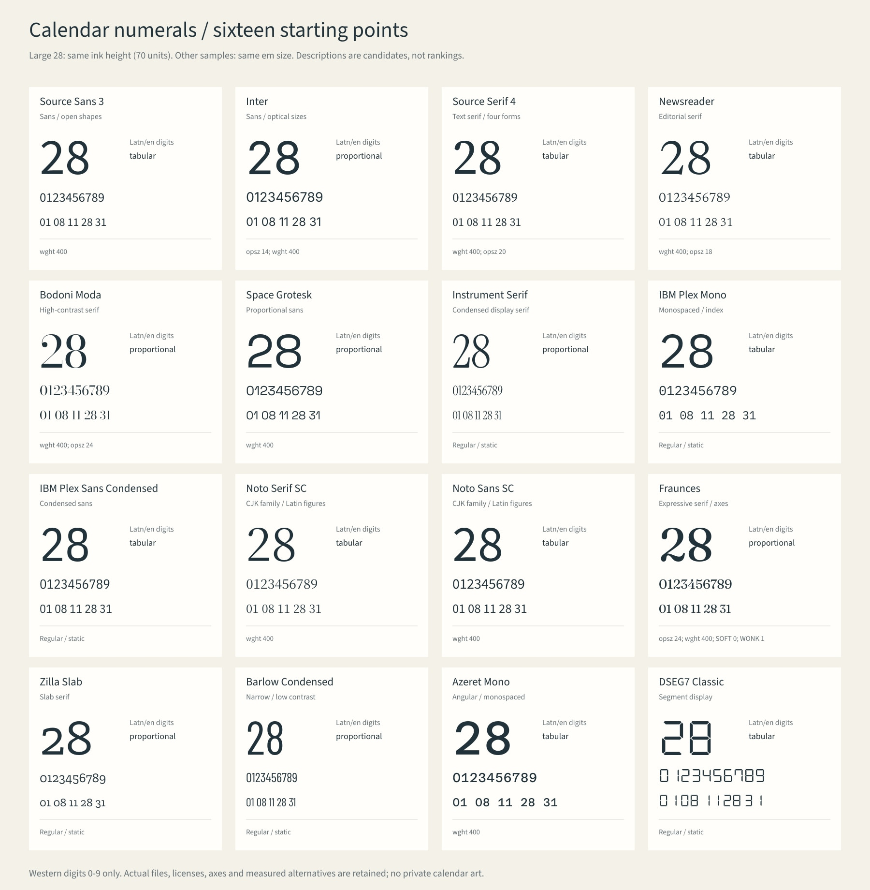
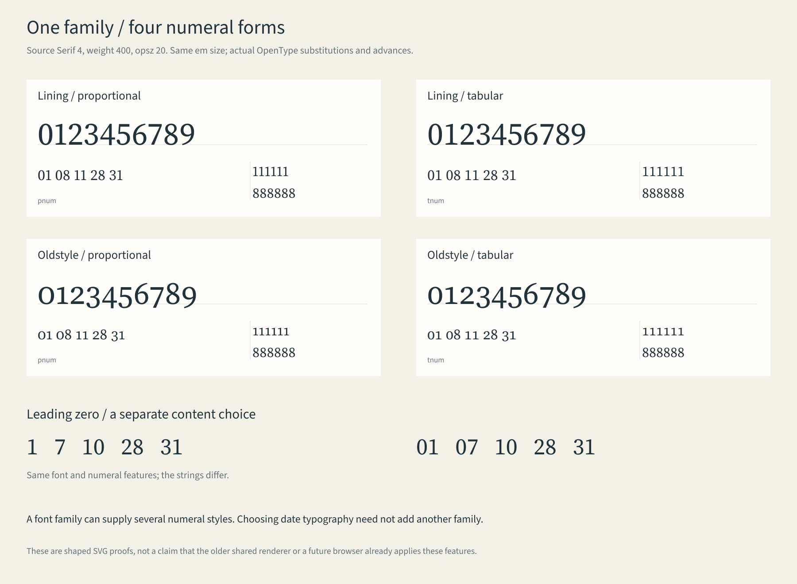
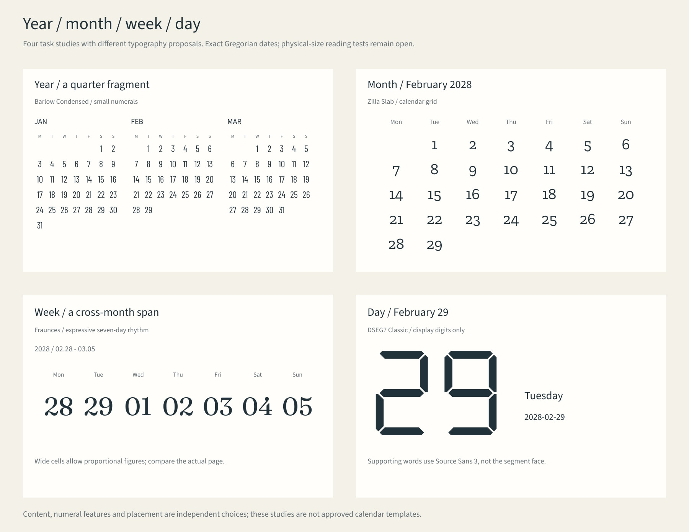

# 日历数字：独立角色、字体素材与实际字样

2026-10-30。本页接入[素材库](material-library.md)与[字体排版专题](type-layout-library.md)的同一索引。为已有11家族增加数字档案，另保留5家族原字体，合计**16家族的数字候选档案**；新增7条一手阅读、3个条件设计条目和3张原创研究板。既有字体不重复下载或改写。

## 日号可以独立选择，也可以沿用同一家族

日号、星期、月份／年份、书名是不同的文字角色。独立选择意味着分别决定它们需要的字形、样式和尺度，最终允许共享同一家族；不意味着每个角色必须用另一种字体，更不要求使用只含数字的文件。

| 选择层 | 例子 | 与其他层的区别 |
| --- | --- | --- |
| 家族与实例 | Source Serif 4或Source Sans 3；具体字重、原生样式、光学轴 | 家族名称不能代替文件、样式和坐标 |
| 数字高度形式 | 等高`lnum`／旧式`onum` | 不能由字宽判断；家族名里的“Old Style”也不等于启用`onum` |
| 数字宽度形式 | 比例`pnum`／等宽`tnum` | 等宽数字不要求整套字体是mono；七个固定中心也可容纳比例数字 |
| 日期内容格式 | `1`还是`01`，日期范围和分隔符 | 补零改变字符串，`tnum`不会自动添加0 |
| 版面关系 | 位置、单元宽度、字号、字距、与星期的配对 | advance、墨迹宽、侧边空白和日期格锚点分别检查 |

[CSS Fonts4数字语法](https://www.w3.org/TR/2026/WD-css-fonts-4-20261022/#font-variant-numeric-prop)把宽度与高度形式分成可组合的选择；该版本是Working Draft。本轮实际渲染使用HarfBuzz，未据此宣称网站或旧导出器已支持这些CSS设置。[CLDR日期字段](https://www.unicode.org/reports/tr35/tr35-79/tr35-dates.html#Date_Field_Symbol_Table)支持将`d/dd`与字体数字形式分开处理。


这是选材流程，不是已经建成的网页界面。未来配方可分别保存书名、日号、星期和年月的字体角色，并允许它们引用同一文件。

## 16家族的实际数字候选



大号`28`匹配墨迹高度70，其余两行保留相同em字号。两种研究方式都不保证感知大小相同，也不为字体排名。全部字样来自本项目代码与实际字体；没有复制厂商作品图或真实用户样张。

| 候选方向 | 已保留的家族 | 适用条件与取舍 |
| --- | --- | --- |
| 无衬线查读 | Source Sans 3、Inter、Space Grotesk、Noto Sans SC | 比较小日号、七日横栏及语言配对；彼此形态和功能并不相同 |
| 正文／编辑衬线 | Source Serif 4、Newsreader、Noto Serif SC | 尝试与书名和正文建立关系，逐样式、语言核对数字表现 |
| 展示衬线 | Bodoni Moda、Instrument Serif、**Fraunces** | 大日号或宽松周栏候选；细线、笔画对比与表现性需要真实尺寸检查 |
| 粗衬线 | **Zilla Slab** | 观察衬线形态与数字节奏；不因slab标签直接判定更清楚 |
| 窄体 | IBM Plex Sans Condensed、**Barlow Condensed** | 格宽受限时的真实窄体候选；不把常宽字体横向压扁 |
| 等宽节奏 | IBM Plex Mono、**Azeret Mono** | 编目感、固定宽度或展示角色；等宽不是所有日历的默认审美 |
| 数码显示 | **DSEG7 Classic** | 作为有意采用的七段日号；辅助文字和分隔符另用有覆盖的字体 |

粗体5家族为新增原资产，共5份字体与5份原始OFL，合计884,368 bytes，见[来源与许可](../assets/fonts/numeral-study/README.md)。Fraunces原始默认`wght=900`、Azeret Mono默认100；研究板明确选400。Fraunces另选`opsz=24`、SOFT0、WONK1。轴、默认值、文件版本与修改记录分开保存。

每个[数字档案](../assets/fonts/numeral-study/profiles.json)关联已有font ID、具体原文件、来源哈希、研究实例、候选用途、适用尺度、局限及研究图。素材索引直接附加这些档案；`--numeral-use dense-grid`／`large-day`按候选用途筛选，通用`--scale`仍表示字体可参与该尺度的其他文字角色。后续功能可以查询日号候选，而不是重新从一串字体名称猜测。

## 一个家族也能有不同的数字



上图实际启用Source Serif 4的四组数字特性，保持同一字重、光学坐标和em字号。等高／旧式与比例／等宽分别变化；基线和`111111`／`888888`帮助检查字形与占位。下方`1/01`只改变文字内容。

完整[实际塑形审计](research/numeral-feature-audit.md)及[数据](research/numeral-feature-audit.json)覆盖16家族、19份Roman／Italic文件，保留所请求特性、glyph ID、advance、偏移、墨迹及相对默认的变化。

值得保留的边界：

- Azeret Mono的`tnum`保持宽度不变，却改变1–9轮廓；占位与字形变化分开记录。
- 某个开关没有可见变化，可能是默认已经采用该形式，不等于功能失效。Source Sans 3虽无显式`tnum/lnum`标签，也可利用默认和`pnum/onum`得到四种组合。
- **Noto Serif SC在400／Latn下，en默认经`locl`变为等宽数字；zh-Hans则保留比例宽数字。** 早期库的raw-cmap／hmtx实测仍有效，但不能当作所有语言下的最终输出。关闭`locl`只作诊断。
- Newsreader指定Italic文件在本次400／默认opsz18下，显式`tnum`仍有“7”宽于其他数字；不能沿用Roman指标。Space Grotesk旧式等宽组合的1单位微差另行保留，不据此裁决字体缺陷。
- [DSEG作者规格](https://www.keshikan.net/fonts-e.html)区分DSEG7／14与Weather。Weather的0–9映射天气图标；本次保留的是DSEG7 Classic。它缺少`/`，七段字母也不当作普通正文；句点零advance有特定显示语义。

## 回到年／月／周／日



研究板分别展示季度片段、闰年二月、跨月七日和单日大数字。日期均来自现有确定性公历工具；不同版块改变了字体、字号与组织任务，属于整体情境提案，不作单变量因果比较，也未完成实际打印阅读测试。

选材时先分配任务：年历需要密集定位，月历需要1–31与行列关系，周历可有更宽松的数字节奏，日历大日号可以承担展示。不能据此把某个家族固定绑定一个尺度。书写、挂墙远看、桌面近看和屏幕仍需分别检验。

新入库的三个方法是`num-role-and-family`、`num-format-and-zero`、`num-symbol-semantics`；数字宽度／高度与尺度研究继续复用已有`type-numeral-roles`、`type-size-context`，避免重复建设。完整来源见[7条阅读记录](research/numeral-design-research.md)。

## 检索与重建

```sh
python3 scripts/material_catalog.py --domain typography --tag date-type --kind font --json
python3 scripts/material_catalog.py --tag date-type --numeral-use dense-grid --json
python3 scripts/material_catalog.py --scale week --role numeral-selection --json
python3 scripts/material_catalog.py --role numeral-format --json
python3 scripts/material_catalog.py --role numeral-coverage --json
python3 scripts/design_catalog.py --scale day --domain typography --json

python3 -m pip install -r requirements-numerals.txt
python3 scripts/render_numeral_atlas.py
python3 scripts/audit_numeral_features.py --out-dir tmp/numeral-audit-replay
python3 scripts/design_catalog.py --build
# 可选JPG预览需要sharp 0.35.5
node scripts/render_numeral_previews.mjs /absolute/path/to/node_modules
```

新增`glyph_study.py`是独立的水平LTR、明确Latn/en语境的SVG研究路径，实际应用HarfBuzz功能；没有改写旧`design_scene.py`，也不提供段落、竖排、回退、全Bidi或PDF导出。保留文件的实际功能与渲染环境分别检查，不把研究能力冒充已上线产品。

源字体保持原字节与许可；`tmp/numeral-study-fonts/`中的重命名静态ASCII工作子集保留功能闭包、原许可和哈希。它们用于研究，不等于网站加载方案。当前范围是西方阿拉伯数字0–9；其他数字体系、农历与天文符号需另补资料。

字体工作副本的打包方式明确固定为FontTools原序列化器，避免可选uharfbuzz安装状态改变二进制回放；HarfBuzz字形塑形与字体文件的打包是两件事。既有原字体不改写。
