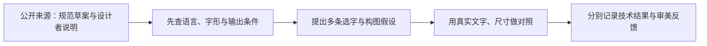

# 中文与中西文排版：约束、选字与审美研究

核对日期：2026-10-30。范围是中文及中西文混排；选择性精读 8 个一手来源。每个来源的实际阅读范围、限制与权利边界见下表及配套 [JSON](cjk-typography.json)。这里的实验是本项目提案，尚未证明某一种风格更好，也不表示当前渲染器已实现完整中文排版。

## 先区分三种知识

| 类型 | 本轮如何使用 | 不能据此声称 |
| --- | --- | --- |
| 排版需求、工程约束 | 语言／地区字形、禁则、字体度量、塑形与输出链是设计成立的条件。 | 正确调用字形、没有裁切就有审美质量。 |
| 字体设计者的目标与批评者的立场 | 学习怎样观察字面、内部空间、笔画和骨架；同时保留作者及适用场景。 | 宋体永远最好读、某个地区的字体普遍更美、细字必然更精致。 |
| 本项目的迁移假设 | 固定真实文字和输出条件，制作小规模对照；保留选择理由和不确定点。 | 这些条件卡是已经验证的用户偏好或自动评分规则。 |

[CLREQ](https://www.w3.org/TR/2026/DNOTE-clreq-20261007/) 是 2026-10-07 **Group Note Draft**，原文明确声明尚未经 W3C 及其会员认可。这里只把它作为可追溯的在研需求资料。[Google Fonts 的垂直度量说明](https://googlefonts.github.io/gf-guide/metrics.html)则是特定字体服务的工程指南，尤其不能把其中拉丁字体的数值直接改写成中文日历的“最佳行高”。

图中后四步是提议的研究流程，需在具体作品中执行；不是当前代码能力清单。

## 此次阅读改变了哪些判断

**同字号、同墨迹高度、同视觉大小是三件事。** CLREQ 区分文字外框与字面；justfont 的中宫实验进一步提醒：即使外轮廓尺度接近，内部笔画分布仍可改变大小感。[CLREQ §6.4](https://www.w3.org/TR/2026/DNOTE-clreq-20261007/)、[中文字型设计第二课](https://blog.justfont.com/2012/12/hanzi-type-design-2/)。本项目由此提出：等墨迹高度只能帮助诊断，不能当作最终配字结果；还应观察一段文字的浓淡、字与字之间的内外空白，而非只量包围盒。

**字体类别只是起点，选字应能说出形式关系。** Google Fonts 的课程以构造、笔画对比和细部讨论配字；justfont 的八款明体比较把同一类型内部的差异展开。[Font Matrix 课程](https://fonts.google.com/knowledge/choosing_type/pairing_typefaces_based_on_their_construction_using_the_font_matrix)、[明体比较](https://blog.justfont.com/2023/09/whyjpdesign/)。本项目可并行尝试同族互补、形式呼应、有意对比三条路线；关系是否成立，回到具体文字、角色和版面判断。拉丁 a／e／o 的结构模型不直接成为汉字分类法。

**字重需作为设计过的字形选择。** Adobe 的思源宋体提供七个原生字重，justfont 说明了软件模拟粗体与真实字重的差异。[Adobe ReadMe p.1–4](https://github.com/adobe-fonts/source-han-serif/blob/release/SourceHanSerifReadMe.pdf)、[粗体应用文章](https://blog.justfont.com/2025/01/extrabold-font/)。本项目需要比较真实输出中的细节保留与角色层次；更细、更粗都应有内容理由，不能把选字细致自动变成一套细字重风格。

**语言能力要独立验收。** Adobe 的部署说明揭示了地区字形、语言标记和 `locl` 的依赖。[Adobe ReadMe p.3–4](https://github.com/adobe-fonts/source-han-serif/blob/release/SourceHanSerifReadMe.pdf)。本项目不能从“装了泛 CJK 字体”推出“支持各地中文”；同样，竖着摆出几个字也不等于具备直排段落、标点和混排能力。

## 可执行的研究卡

以下操作、代价与实验均为本项目提出，`proposed-unvalidated`；来源只提供启发依据。测试用语是原创中性文本，不含真实用户案例。

### 1. 字面／实际墨迹／视觉大小分开观察

- **触发条件：**中文标题、数字与西文在相同字号下显得大小或轻重不协调。
- **设计操作：**保留同 em 样张观察字面，再做等墨迹高度的诊断副本；最终仍回到真实词句和构图，调整字号或配对。
- **反例／代价：**等墨迹高度也不能消除内部空间、笔画密度和开口造成的视觉差异；只比较孤字会遗漏段落灰度。
- **可见实验：**固定同一短标题、日期和 3 行原创说明；分三列展示原字号、等墨迹高度、人工补偿。标注真实字号与补偿值，比较角色关系，不能仅以包围盒相同判胜。
- **依据：**`cjk-clreq-2026`、`cjk-justfont-hanzi-2`、`cjk-justfont-ming-comparison`。

### 2. 真实尺寸下建立字重层次

- **触发条件：**标题、星期和注释层次模糊，或为了精致而把所有文字都变细。
- **设计操作：**为每个角色比较原生字重与实际成品尺寸；先保留日期的识别任务，再选择标题的笔画表现。
- **反例／代价：**同一 wght 数值跨字体不可比；屏幕大图的纤细感可能在缩小或纸面输出后丢失。粗标题和细标题都是候选。
- **可见实验：**内容、构图、尺寸固定，仅比较 3 个真实字重组合；各附一个实际输出尺寸局部和观看距离检查，记录可读与喜欢两项独立结果。
- **依据：**`cjk-adobe-serif-readme`、`cjk-adobe-serif-design`、`cjk-justfont-native-bold`。

### 3. 先处理文本边界，再评估疏密

- **触发条件：**说明文字或长标题会自动换行，特别是窄栏或手机预览。
- **设计操作：**显式选择地区及禁则策略，先考虑标点宽度，再处理换行和不可拆串；短展示标题允许人工决定行分。
- **反例／代价：**为了禁则把一行过度拉开，会制造更严重的节奏问题；不能把所有标点强制半宽或一概悬挂。
- **可见实验：**用原创压力串“在书页之间，寻找时间。《一周一书》（2027）……”在窄、中、宽三栏比较；检查行头句号、行尾开括号、拆开的省略号与日期数字。该串只用于排版测试。
- **依据：**`cjk-clreq-2026`。

### 4. 中西配字比较构造与角色

- **触发条件：**作品同时包含中文题名、英文名、年份和日期。
- **设计操作：**给出同族互补、形态相近和主动对比三种假设；逐一记录笔画对比、开口、末端、数字宽度及视觉大小。
- **反例／代价：**“宋配衬线、黑配无衬线”不能自动保证协调；有意冲突也可能服务主题。Latin skeleton 模型不直接分类汉字。
- **可见实验：**同一内容与构图各换一组配字，先比较层次和总体节奏，再看局部标点与基线。若同时换色或换图，应标记为整套方向，不能归因给某种字体。
- **依据：**`cjk-google-font-matrix`、`cjk-justfont-hanzi-2`、`cjk-adobe-serif-design`。

### 5. 地区字形与导出能力单独验收

- **触发条件：**同一模板允许简体、台湾繁体、香港繁体或跨浏览器／PDF 导出。
- **设计操作：**保存语言／地区、字体具体文件与版本、排版引擎能力；检查地区字形、基线及裁切。
- **反例／代价：**字体家族名、字符覆盖和成功导出都不能代替本地化字形与视觉检查。
- **可见实验：**用“一 字 好 松”和实际标题分别生成目标地区版本并与字体官方样字核对；再测带上下伸部西文的混排行，比较浏览器与导出图。只宣称已实际检查的语言和格式。
- **依据：**`cjk-adobe-serif-readme`、`cjk-google-vertical-metrics`。

### 6. 直排是文本配置，不是整块旋转

- **触发条件：**采用纵向中文标题、月份或竖排摘句。
- **设计操作：**明确中文推进方向、标点位置、西文旋转与数字纵中横的分工；优先以少量真实内容验证。
- **反例／代价：**把英文逐字竖堆可能破坏词形；四位年份硬压进一字宽会降低辨识。小片段排成直行不等于已支持完整直排段落。
- **可见实验：**同一原创标题分别制作横排、直排汉字＋单列数字、直排汉字＋纵中横日期三种局部；带一段英文词与括号压力测试，评估阅读路径及构图价值。
- **依据：**`cjk-clreq-2026`、`cjk-adobe-serif-readme`。

### 7. 中西边界间距与全局字距分开

- **触发条件：**中文说明夹有数字、英文词或书目编号，界面间距看似均匀而文字被切碎。
- **设计操作：**把汉字—西文边界、英文词内间距、中文标点边界分开配置；不以全局 tracking 或逐字手动空格替代。
- **反例／代价：**拉开所有字符会破坏英文词形，也可能重复中文标点自带的空白；紧排未必能通过整体加大字距解决。
- **可见实验：**以原创串“第12周，阅读 Book 02。”比较仅中西交界处的 0、0.125、0.25 em 间距，保留标点例外并另看窄栏换行。以上是对照条件，不是默认参数。
- **依据：**`cjk-clreq-2026`。来源 §6.3.3 描述至多 1/4 em 的中西间距与标点、行边界例外；这与全局字距是不同操作。

## 如何评价这组对照的审美

技术检查后，不用“高级”“文艺”替代观察。对每一版用实际局部说明：第一眼落在哪里；中文与数字是呼应还是争夺；短标题的起止边缘是否有张力；疏密与空白是否形成一贯节奏；词句是否被拆成无意的碎块；同一系列更换长短文字后是否仍成立。这些是本项目的评审问题，不是来源给出的评分表。

同一对照尽量只改变字号补偿、字重或配字关系中的一项；整套创作方向可以同时变化，但不能据此归因某一个变量。日期辨识、文字正确与导出稳定单独记录；喜欢哪条表现路线仍需作品和用户评价。没有得到反馈的路线保留为未知。

## 来源卡与实际阅读范围

这里只列短定位；JSON 保存完整 `actual_reading`、`findings`、`limitations` 和 `rights_status`，可供素材索引按关键词及时间尺度引用。

| 稳定 ID／公开原文 | 一手来源类型 | 实际阅读范围 | 主要边界 |
| --- | --- | --- | --- |
| `cjk-clreq-2026` [Requirements for Chinese Text Layout／中文排版需求（2026-10-07）](https://www.w3.org/TR/2026/DNOTE-clreq-20261007/) | first-party-layout-requirements-draft | Status of This Document；§2.1.2–2.1.3 横直排差异、直排混排；§6.1.1–6.1.2 行首行尾与不可拆分符号；§6.2.2 行内调整；§6.3.1.3、6.3.2–6.3.3 字距、标点、横排混排；§6.4 基线、行高；§7.1.3 标题 | 描述中文出版惯例及需求，不提供本项目的具体排版实现；不是已获认可的 W3C 标准。 |
| `cjk-adobe-serif-readme` [Source Han Serif ReadMe v2.003（2024-07-30）](https://github.com/adobe-fonts/source-han-serif/blob/release/SourceHanSerifReadMe.pdf) | first-party-font-technical-documentation | PDF p.1–2：概览、地区字形与七字重样例；PDF p.3–4：Configurations，语言默认值、locl 与地区子集 | 字体有相关字形不等于任意导出器会正确调用。 |
| `cjk-adobe-serif-design` [Source Han Serif Design Guide v2.0（2021-10-25）](https://github.com/adobe-fonts/source-han-serif/blob/release/SourceHanSerifDesignGuide.pdf) | first-party-typeface-design-rationale | 单页设计说明：中部字形设计与长文目标段落；右侧五语种、七字重样字；末段与 Source Han Sans 的关系 | 这是该字体的设计意图，不是阅读实验或所有宋体的规律。 |
| `cjk-google-font-matrix` [Pairing typefaces based on their construction using the Font Matrix](https://fonts.google.com/knowledge/choosing_type/pairing_typefaces_based_on_their_construction_using_the_font_matrix) | first-party-type-education | 开篇：配字没有绝对规则；Three layers：skeleton／contrast and serifs／finer details；Pairing section：相近结构与有意对比两条路径 | 主要以拉丁字母结构举例，不能把 a、e、o 的模型直接当成汉字分类标准。 |
| `cjk-google-vertical-metrics` [Google Fonts Guide — Vertical Metrics](https://googlefonts.github.io/gf-guide/metrics.html) | first-party-font-engineering-guide | 开篇：不同平台解释垂直度量的差异；CJK Vertical Metrics 小节：em-box、BASE、vhea／vmtx 与兼容性 | 这是一家服务的字体工程规则，不是日历行高的美学标准。 |
| `cjk-justfont-hanzi-2` [字型設計自己來｜中文字型設計的第二課（But，2012-12-25）](https://blog.justfont.com/2012/12/hanzi-type-design-2/) | first-party-foundry-education | 正文：字面与中宫的区别；同字级／同字面模拟不同内部空间的比较；末段：与西文字体 x-height／字腔的类比 | 模拟案例与经验描述不等于普遍心理学证据。 |
| `cjk-justfont-ming-comparison` [日本的字體設計比較好看？讓我們從明體說起（Rong，2023-09-04）](https://blog.justfont.com/2023/09/whyjpdesign/) | first-party-foundry-design-criticism | 正文：八款明体以相同内容、字级、字距、行距比较；骨架／血肉、收笔和横向展开的逐项观察；地区字形及标点识别讨论 | 作者的长文用字立场是设计批评，不是证明宋体永远更易读的研究。 |
| `cjk-justfont-native-bold` [不是按「B」就有？中文粗體吸睛字體推薦與免費下載點一次看（陳弘量，2025-01-22）](https://blog.justfont.com/2025/01/extrabold-font/) | first-party-foundry-font-usage-guide | 正文：软件模拟粗体与原生粗体；字重家族与层次关系；标题展示字体和长文适用情境 | 字体厂商的使用指南含推广目的，不是覆盖所有渲染器的实测。 |

## 权利与资料边界

所有来源卡统一为 `research-only`：知识引用不等于允许在公共模板中重用原图、文章版式或字体文件。本轮未把第三方网页图片、字体和 PDF 放入仓库。Adobe 两份 PDF 仅在临时目录阅读；文章的图片只在原站阅读。

justfont《中文字型设计的第二课》页面标示 CC BY-NC-ND 4.0；本研究没有改绘或导入其图例。Google Fonts 课程官方源码位于 `cc-by-sa` 内容目录，本记录仍仅保存短原创概述。Adobe 关于字体的 OFL 说明不能替代对设计指南插图或其他文章内容的许可判断。未来真的选择字体或视觉素材时，要另记具体文件、版本、来源及相应授权范围。

该资料可以作为基础 skill 的输入，但不应直接写成默认风格、字体排行榜或“审美已验证”的规则。
