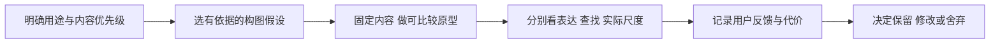

# 排版、构图与审美：一手案例精读

研究日期：2026-10-30。目标是为年历、月历、周历、日历提供可选择、可检验的构图策略，扩大审美范围。这里没有把“书籍主题”直接等同于衬线体、米色纸或大留白，也没有把用户对上一版的否定解释为对某一设计流派的否定。

完整来源卡、实际阅读位置、迁移条件、实验与版权状态见 [layout-aesthetics.json](./layout-aesthetics.json)。共精读 7 个一手来源。MoMA 的海报与 Letterform Archive 的 1972 年双封面完成了图像审看；Irma Boom 访谈依据文字；Pentagram 案例完成官方正文阅读，但作品图片访问受限，**不据此声称已验证画面质量**。

## 不同立场可以同时进入素材库

| 立场与证据 | 可学习的关系 | 需要付出的代价或满足的条件 |
| --- | --- | --- |
| [Tschichold 的非对称海报](https://www.moma.org/collection/works/7292)；馆方说明与实际看图 | 大标题、次级信息、空白和底部索引共同形成阅读主轴 | 必须选定优先入口；偏置不能代替层级判断 |
| [Weingart 的实验](https://letterformarchive.org/news/from-the-collection-legacies-of-swiss-style-part-2-wolfgang-weingart/)；档案分析与双封面审看 | 错落、阻力和不稳定可以成为表达的一部分 | 阻碍阅读要有内容理由；日期查找需单独验证 |
| [Irma Boom 的设计者访谈](https://archis.org/volume/interview-irma-boom/) | 内容、开本、纸张与实体模型影响字体和结构选择 | 个人设计立场并非普遍规范；不能据此忽略用户 |
| [Build, Memory](https://www.pentagram.com/work/build-memory-1)；工作室正文 | 灵活网格、图像尺度和编号组织高密度资料 | 图像与索引关系需要读者能理解；轻盈感尚未独立验证 |
| [Architecture Unbound](https://www.pentagram.com/work/architecture-unbound)；工作室正文 | 载体、网格、裁切与文字方向可以共同响应主题 | 特殊形制影响生产与适配；案例角度不是通用参数 |
| [Typography 36](https://www.pentagram.com/work/typography-36)；工作室正文 | 有特征的组织页可统合不同作品，表现字体可以有意反常规 | 框架可能抢主体；字体变形许可须另查 |
| [The Public Theater 2020–2021](https://www.pentagram.com/work/the-public-theater-2020-2021-season)；工作室正文 | 固定身份与按内容变化的表达层可以并存 | 宣传中的强刺激未必适合家庭长期观看 |

## 对日历设计语言的补充

**网格首先组织关系。** 它可以隐藏在对齐与节奏中，也可以带有方向；选择自由结构时，同样需要交代入口、图文关联和视线如何移动。来源提供了不同方向，尚未证明其中一种更适合本项目用户。不要把规则网格当成保守，把破网格当成有创意。

**留白和密度要连同内容看。** 同样的信息量，等大方块、主图带辅图、紧密文字带宽阔边界，会产生不同节奏。空白不是越多越好，密度也不是内容越多越差。可以记录页面上各部分如何相互支撑，避免用单个空白百分比评判品质。

**图像与文字不只有“上图下字”。** 可试验图像作为主体、图像作为资料、文字本身作为画面，以及多个材料通过编号或邻近关系组成叙事。选择前要说明：这周让用户首先看见一本书、一个场景、一段内容，还是时间本身？设计实验可暂定答案，最终由反馈修正。

**字体属于内容和载体。** 先明确观看距离、实际尺寸、语言、日期与书籍内容的职责，再试字族和字重。允许同一家族解决多种角色，也允许第二家族表达真实的内容分层。不能把“两套字体搭配”当成品质保证。

**系列需要稳定项和变化理由。** 可稳定日期定位、导航、字号角色或页面比例，另选与书目内容有关系的变化项。变色、变形和移位都不应只是为了每页不同；需要看连续页面，观察识别、节奏和疲劳。

## 下一轮可执行的比较实验

全部采用原创图像、原创短文与已核验许可的字体。每次保留相同书目内容与日期，先明确只改变哪个因素，避免把内容好坏误当成排版效果。

| 实验 | 控制与变化 | 分开观察 |
| --- | --- | --- |
| 构图主轴 | 字体、图像与信息量固定；比较居中平衡与偏置平衡 | 第一眼入口；近看能否定位日期；画面是否符合意图 |
| 表达张力 | 日期层固定；标题层仅打破一个规则 | 情绪是否改变；阻力是否有意义；是否干扰时间读取 |
| 图文密度 | 内容量固定；比较等大模块与一主多辅 | 图文关联是否明确；重点是否被淹没；是否有多余导航 |
| 尺寸与字族 | 同内容制作两种实际尺寸纸模型，再比较一或两套字体 | 观看距离、物理比例、角色区分；不只放大屏幕截图 |
| 连续页面 | 做三张相邻周页；固定锚点，只改变一个主题相关参数 | 能否辨认同一系列；差异是否有理由；连续观看是否疲劳 |

这是建议的研究与原型流程，**不是当前产品已实现的功能**。设计者或机构的说明提供可测试假设；运行无报错、日期正确、字体加载正常，只代表技术检查通过，不能替代审美认可。

## 资料与资产边界

本批记录均为 `research-only`。资料库保存来源链接、短分析与迁移条件，不分发原始海报、书页、采访配图或字体文件。浏览到图片不代表取得复用许可；Typography 36 的专门字体修改许可也不适用于本项目。具体项目风格、书口角度、标志性字形组合等不能被当作现成模板。进入可复用资产库之前，应另做原创或取得适用授权。
