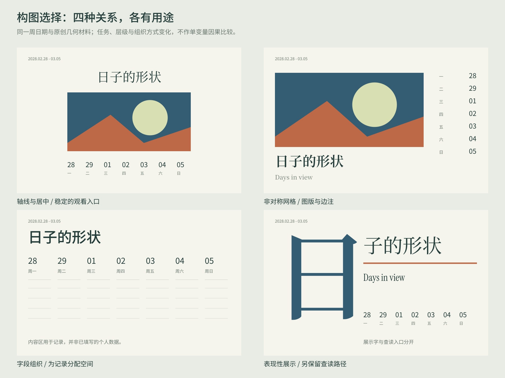

# 字体与排版：研究、取舍与可用材料

2026-10-30。本页是[统一设计总览](design-atlas.md)与[素材库](material-library.md)的专题入口，已接入相同索引。基础整理有 **26 条阅读记录，涉及 25 个去重页面**：中文／混排 8 条、选字／配字／数字／光学设计 8 条、构图审美 7 条、设计师立场／渲染边界 3 条。同一 Font Matrix 页面保留两个阅读视角，不算两个独立来源。

[英文专项扩展](latin-type-library.md)另增14条阅读记录、6个字体家族、5个条件条目和2张英文字样板；该阶段合计40条字体／排版阅读记录与15个条件条目，均接入原索引。[数字专项](numeral-font-library.md)另增7条阅读、5家族、3个条件方法，并为全部16家族建立数字档案；当前合计47条字体／排版阅读记录与18个条件条目。

每条保留阅读位置、实际范围、适用条件、反例及权利说明。原书、论文和网站作品图没有被镜像进素材库；本轮所有研究图均为项目原创。

## 三种依据分别使用

| 层 | 来源例子 | 用法与边界 |
| --- | --- | --- |
| 排版约束与语言惯例 | [CLREQ 2026 草案](https://www.w3.org/TR/2026/DNOTE-clreq-20261007/)、Adobe 字体配置、Google 垂直度量 | 明确字形地区、混排、标点与换行；另验实现。CLREQ 是 Group Note Draft，不称为已获 W3C 认可的标准 |
| 字体设计与实现知识 | Google Fonts Knowledge、Adobe 设计说明、IBM、[HarfBuzz](https://harfbuzz.github.io/what-is-harfbuzz.html) | 对比骨架、字面、角色、字重、数字和实际特性；字体拥有的能力与渲染器执行的能力分开 |
| 设计者／机构的审美立场 | [Butterick](https://practicaltypography.com/mixing-fonts.html)、[Tschichold / MoMA](https://www.moma.org/collection/works/7292)、[Weingart / Letterform Archive](https://letterformarchive.org/news/from-the-collection-legacies-of-swiss-style-part-2-wolfgang-weingart/)、Irma Boom、Pentagram | 理解任务与取舍；对称、非对称、简约、密集、规则或表现性都需回到作品检验 |

原始记录：[中文与混排](research/cjk-typography.md)、[字体选择](research/font-selection.md)、[构图审美](research/layout-aesthetics.md)、[设计立场与实现边界](research/type-rendering-boundaries.json)。规范不决定哪种作品更美，某位设计师的立场也不自动成为本项目规定。

## 基础十个可检索的条件条目

完整数据见 [type-layout-elements.json](../assets/library/type-layout-elements.json)：条件、选择、代价、反例、来源 ID、字体候选和研究图都可追溯。它们是待具体使用验证的方法，不是审美评分器。

| 条目 | 设计问题 | 保留的选择空间 |
| --- | --- | --- |
| `type-role-first` | 书名、日期和附注分别需要什么字 | 同一家族或多家族分工均可 |
| `type-role-pairing` | 两种字体为何放在一起 | 骨架呼应或主动反差，不强制宋黑搭配 |
| `type-size-context` | 同字号为何看起来不一样大 | 同 em、同墨迹和视觉大小分别看；光学版本另查 |
| `type-numeral-roles` | 数字应便于对齐还是承担展示 | 等宽／比例、等高／旧式分开，按任务检验 |
| `type-cjk-language` | 混排、标点与地区字形 | 字面、基线、语言标签与出版惯例共同决定 |
| `type-shaping-support` | 字体特性真的生效了吗 | 字体表、启用设置和实际结果分别记录 |
| `layout-axes-grid` | 图像、标题和日期如何关联 | 居中、非对称、方向性网格均可有秩序 |
| `layout-expressive-density` | 密度与表现性服务什么 | 阅读阻力可以有目的；密度不直接代表品质 |
| `layout-space-scale` | 空白、尺寸与载体改变什么 | 分组、停顿、书写或边缘张力；需要实体情境 |
| `layout-series-variation` | 多页如何相关又有区别 | 必要身份锚点与内容驱动的变化 |

[Irma Boom 的原始访谈](https://archis.org/volume/interview-irma-boom/)把内容、开本与原型放进过程，提示字体不必脱离整体概念先被固定。[Build Memory](https://www.pentagram.com/work/build-memory-1)讨论大量材料的组织；其图片访问受限，本轮只按官方正文研究，尚未将具体跨页当作视觉质量标杆。

## 字体资产与原创研究

新增 [Noto Serif SC 与 Noto Sans SC 原字体及 OFL](../assets/fonts/type-study/README.md)，与原有 Instrument Serif、IBM Plex Mono、IBM Plex Sans Condensed 构成基础五家族；[英文扩展](latin-type-library.md)另保留六家族，数字专项扩充后素材库合计十六家族，均为候选。新增的是可变 TTF；使用时明确字重和目标环境。

两套 Noto 均只有 `wght`，没有 `opsz`，默认字重分别为 200 与 100。在明确的 400 字重下，此处原始 cmap/hmtx 实测 Serif 数字 advance 不全等宽，Sans 数字等宽；不把这个结果外推为所有宋／黑体的规律。[字体 manifest](../assets/fonts/type-study/manifest.json)保留原始字节、版本、Git blob、许可、轴和指标。[数字审计](research/numeral-feature-audit.md)进一步显示该 Serif 在 Latn/en 与 Latn/zh-Hans 下有不同实际替换结果，原始指标与塑形结果分别记录。




研究使用原创中性文字、几何场和公开日期，没有复制真实用户作品或研究来源的图像。构图的任务和层级不同，不是单变量实验，也不作高低排名；四份独立 SVG 可继续用于编排研究。

当前证明使用默认字形轮廓、advance 与显式 tracking，**未实现完整塑形、自动 kerning、连字、地区替换、中文断行或标点挤压**。这些能力必须在最终渲染环境另验，不能从字样图推定已工作。

## 检索与重建

```sh
python3 scripts/design_catalog.py --scale week --domain typography --json
python3 scripts/material_catalog.py --domain typography --role font-pairing --json
python3 scripts/material_catalog.py --domain typography --query 混排 --json
python3 scripts/material_catalog.py --domain layout --kind design-element --json
python3 scripts/material_catalog.py --domain typography --shareable-only --json

python3 scripts/render_type_layout_atlas.py
python3 scripts/design_catalog.py --build
```

`--query` 是字面关键词查找，不是语义检索。`--shareable-only` 仅筛出已记录 CC0/OFL 的资产并保留条件，排除研究作品和未选公共许可的原创条目。

字体准备脚本从保留的原始 VF、固定轴值及 FontTools 版本，在 `tmp/type-layout-fonts/` 生成重命名静态工作副本并附原许可。它们不是新的字体设计；最终配方仍应保留实际选中文件和哈希。SVG 保留轮廓，文字与布局保留在生成器。可选 JPG 预览使用 `render_type_layout_previews.mjs` 与 sharp 0.35.5。


技术检查、设计者判断和用户评价分别记录。本轮更新不把此前某张作品的否定升级为对某类字体、竖排或颜色的永久偏好。
